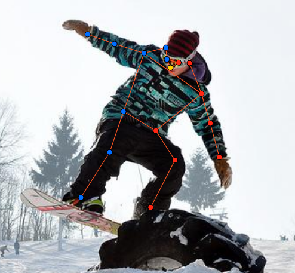
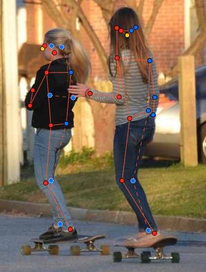
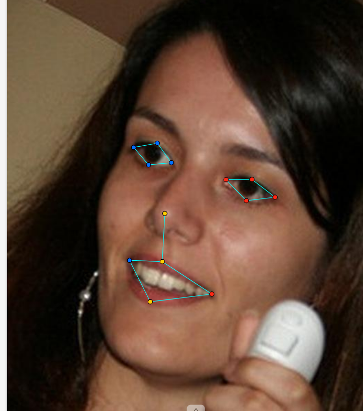
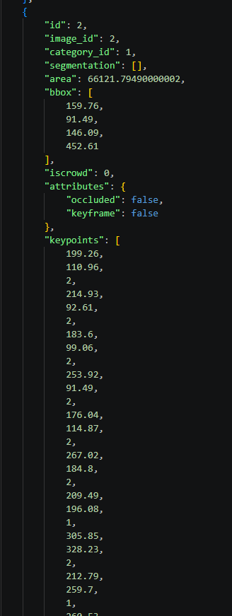

# Báo cáo cá nhân — HoVaTen-MSSV

Đổi tên file theo quy tắc `MSSV_HoTen.md`. Ví dụ: `20241234_NguyenVanAn.md`.

Dữ liệu: 12 ảnh người COCO val2017 (Lin et al., 2014) và 8 ảnh chân dung Wikimedia Commons, chỉ dùng trong lớp.

## 0. Thông tin học viên

- Họ tên: Dương Trí Dũng
- MSSV: 2A202603341
- Email: 26ai.dungdt4@vinuni.edu.vn
- Link repository: https://github.com/hurtmyneck/K5-L2B-DAY04-2A202603341-KeypointPose-Student
- Phiên bản CVAT (Help → About): 2.74.1
- Máy: hệ điều hành windows 11 home · RAM 24 GB · chạy CVAT chế độ đầy đủ
- Bộ ảnh (`src/exports/assignment.json` do `lab.py setup` tạo): có
- Giờ bắt đầu:16h45
- Giờ kết thúc:19h30

## 1. Kiểm tra label (CP0)

| Label    | Kiểu     | Số điểm | Tên điểm đúng bảng của lab? | Đúng thứ tự? | Số cạnh |
| -------- | -------- | ------: | --------------------------- | ------------ | ------: |
| `person` | Skeleton |      17 | có                          | có           |      19 |
| `face`   | Skeleton |      13 | có                          | có           |      13 |

Mẫu `person` dựng theo người quay mặt về camera (các điểm `left_*` nằm bên phải khung mẫu)? Có / Không

Cách đổi cờ `occluded` / `outside` cho **một điểm** trên phiên bản CVAT này (một câu):

Mở skeleton trong thanh Objects bên phải, chọn đúng điểm cần đổi rồi bấm nút Occluded (che) hoặc Outside (ngoài ảnh) của riêng điểm đó, các điểm còn lại giữ nguyên.

## 2. Số lượng đã gán và thời gian (CP1, CP2)

| Nhóm ảnh   | Số ảnh | Số skeleton đã gán | Số người dưới 60 px (không gán) | Số poster / gương / màn hình bỏ qua | Thời gian (phút) |
| ---------- | -----: | -----------------: | ------------------------------: | ----------------------------------: | ---------------: |
| `easy`     |      5 |                  5 |                               6 |                                   0 |               10 |
| `occluded` |      3 |                  4 |                               0 |                                   0 |               15 |
| `back`     |      2 |                  3 |                               0 |                                   0 |               20 |
| `small`    |      1 |                  1 |                               0 |                                   0 |               10 |
| `crowd`    |      1 |                  3 |                               0 |                                   0 |               15 |
| `faces`    |      8 |                  8 |                               — |                                   0 |               40 |

- Số ảnh người đã xong ở mốc phút 105: 8 / 10
- Thời gian thực tế (phút): CP1 70 · CP2 40 · CP3 5
- Ảnh tốn thời gian nhất là ảnh nào, vì sao?

Ảnh tốn thời gian nhất là ảnh 000000311300.jpg do có 2 người quay lưng, xoay người

## 3. Bảng ca khó (CP1, CP2)

Mỗi điểm bạn phân vân một dòng, nhất là phân vân giữa `v = 1` và `v = 0`, hoặc không chắc hướng người.

| Ảnh              | Người / mặt | Điểm                             | Cờ đã chọn | Phân vân giữa                                           | Lý do chọn                 |
| ---------------- | ----------- | -------------------------------- | ---------: | ------------------------------------------------------- | -------------------------- |
| face_294580.jpg  | mặt         | 4 điểm mắt trái, 4 điểm mắt phải |   occluded | phân vân vị trí mắt                                     | người đeo kính đen che mắt |
| 000000253584.jpg | người       | điểm khuỷu tay trái              |   occluded | phân vân vị trí khuỷu tay trái có bị gối phải che không | dự đoán là có bị che       |

## 4. Bảng tự review (CP3)

Đi từ ảnh cuối về ảnh đầu. 5 ảnh người (ít nhất 2 ảnh `back` hoặc `crowd`) và 3 ảnh mặt. Ít nhất 8 dòng, kể cả dòng `ok`. Ghi lỗi trước, sửa sau.

Mã lỗi dùng đúng một trong: `lr_swap`, `vis_flag`, `position`, `missing`, `extra`, `ok`.

| Ảnh              | Người / mặt | Điểm | Mã lỗi | Ghi chú | Đã sửa? |
| ---------------- | ----------- | ---- | ------ | ------- | ------- |
| 000000542160.jpg | người       |      | ok     |         |         |
| 000000467300.jpg | người       |      | ok     |         |         |
| 000000455536.jpg | người       |      | ok     |         |         |
| 000000359340.jpg | người       |      | ok     |         |         |
| 000000311300.jpg | người       |      | ok     |         |         |
| face_490361.jpg  | người       |      | ok     |         |         |
| face_415073.jpg  | người       |      | ok     |         |         |
| face_300399.jpg  | người       |      | ok     |         |         |

Tổng hợp số lỗi theo mã:

| `lr_swap` | `vis_flag` | `position` | `missing` | `extra` | `ok` |
| --------: | ---------: | ---------: | --------: | ------: | ---: |
|           |            |            |           |         |    8 |

Điểm còn phân vân giữa `v = 1` và `v = 0` (ghi cả hai lựa chọn và lý do chọn):
	Không có
## 5. Kiểm file xuất và kết quả tự kiểm (CP4)

Tự kiểm tay trong file JSON:

| File                  | Người / mặt kiểm (ảnh, thứ tự)                     | Số phần tử `keypoints` | Điểm `outside` ra `v = 0`, `occluded` ra `v = 1`?                                                                                                                                                                                                                                                   | `num_keypoints` khớp?                                  |
| --------------------- | -------------------------------------------------- | ---------------------: | --------------------------------------------------------------------------------------------------------------------------------------------------------------------------------------------------------------------------------------------------------------------------------------------------- | ------------------------------------------------------ |
| `HoVaTen_persons.zip` | 000000122199.jpg: người 1 (id 2) và người 2 (id 3) |               51 và 51 | Người 1: 2 điểm outside (cả hai cổ chân, y = 658,41 và 648,53, vượt chiều cao ảnh 640) ra v = 0; 2 điểm occluded (vai phải, khuỷu phải) ra v = 1. Người 2: 3 điểm outside (vai, khuỷu, cổ tay trái, x vượt chiều rộng ảnh 480) ra `v = 0`; 3 điểm occluded (vai, khuỷu, cổ tay phải) ra v = 1. Đúng | Người 1: 15 = 17 − 2, khớp. Người 2: 14 = 17 − 3, khớp |
| `HoVaTen_faces.zip`   | `face_294580.jpg`: mặt duy nhất (id 5)             |                     39 | 8 điểm mắt (4 trái, 4 phải, kính râm) occluded ra `v = 1`; 5 điểm còn lại `v = 2`. Mặt này không có điểm outside nên không có v = 0. Đúng                                                                                                                                                           | 13, khớp (13 điểm có v > 0)                            |

Sau khi xuất, CVAT ghi `occluded` thành `v = 1` và `outside` thành `v = 0`. Tọa độ của điểm `outside` trong file là `0, 0` hay tọa độ cũ? theo chuẩn COCO thì ghi 0, 0. Điểm v=0 sẽ bị bỏ qua khi huấn luyện

Hai job đã chuyển sang completed trên CVAT? Có / Không
Có
Dán phần **TÓM TẮT** in ra từ `src/check_submission.py`:

```text
----- TÓM TẮT (dán vào báo cáo mục 5) -----
- File person: DuongTriDung_persons.zip
  Số ảnh: 12 · số skeleton `person`: 17 · mỗi annotation 51 số
  Skeleton theo ảnh: 000000090646=1, 000000122199=2, 000000150500=1, 000000176000=1, 000000205650=1, 000000225138=1, 000000253584=1, 000000311300=2, 000000359340=1, 000000455536=1, 000000467300=2, 000000542160=3
  Cờ v: v=2 232 (80%) · v=1 51 (18%) · v=0 6 (2%)
  num_keypoints trung bình: 16.6
- File face: DuongTriDung_faces.zip
  Số ảnh: 8 · số skeleton `face`: 8 · mỗi annotation 39 số
  Skeleton theo ảnh: face_105668=1, face_125051=1, face_196742=1, face_204787=1, face_294580=1, face_300399=1, face_415073=1, face_490361=1
  Cờ v: v=2 96 (92%) · v=1 8 (8%) · v=0 0 (0%)
  num_keypoints trung bình: 13.0
- Ghi chú: 6 điểm v = 0 vẫn mang tọa độ cũ (CVAT 2.x xuất như vậy; chuẩn COCO ghi 0, 0). Không phải lỗi: điểm v = 0 bị bỏ qua khi huấn luyện và khi chấm.
- Số [LỖI]: 0 · số [CẢNH BÁO]: 4
Kết quả: ĐẠT (đọc lại từng cảnh báo ở trên)
```

Các `[CẢNH BÁO]` còn giữ nguyên và lý do:

[CẢNH BÁO] 000000122199.jpg #1: giữ nguyên vì xoay người làm hai chân bị chéo
[CẢNH BÁO] 000000311300.jpg #1: giữ nguyên vì xoay người làm hai chân bị chéo
[CẢNH BÁO] 000000311300.jpg #2: giữ nguyên vì người trong ảnh quay lưng về camera, xoay đầu
[CẢNH BÁO] 000000542160.jpg #2: giữ nguyên vì xoay người làm hai chân bị chéo
## 6. Ảnh chụp màn hình

1. Label `person` trong label constructor (đủ 17 điểm có tên):

   

2. Một người quay lưng đã gán, cờ đã đặt:

   

3. Một khuôn mặt đã gán 13 điểm, phóng to vùng mắt:

   

4. Một đoạn JSON xuất của một người:

   
Nguồn ảnh: COCO val2017 / Wikimedia Commons.

## 7. Tự đánh giá

1. Lỗi bạn mắc nhiều nhất hôm nay, và cách bạn sẽ tránh ở dự án thật:
   Lỗi mắc nhiều nhất hôm nay là chưa đánh thuộc tính outside, khi làm dự án thật sẽ chú ý hơn
2. Một quy tắc bạn đề xuất thêm vào guideline (kèm ảnh ví dụ nếu có):
   Quy tắc đề xuất: phải xác định bên phải của người trong ảnh trước khi gán
3. Nhãn của bạn đi vào model ở đâu? Chọn một lỗi bạn đã sửa và nói nó sẽ làm model học sai thế nào (heatmap, trọng số trong loss, hay bước lật ảnh):
	Nhãn đi vào model ở bước training. Lỗi: có điểm nằm ngoài ảnh nhưng để v > 0 (hoặc kéo về sát mép ảnh) thay vì đánh outside. Hậu quả: điểm đó vẫn thành đỉnh heatmap ở mép ảnh, và vẫn được tính vào loss.
	
## 8. Khó khăn và lỗi kỹ thuật

...

## Bonus (nếu làm)

### B1 — 3 ảnh người khó thêm

| Ảnh | Số skeleton | Số người dưới 60 px | Ca khó nhất |
|---|---:|---:|---|
| | | | |
| | | | |
| | | | |

Kết quả `src/check_submission.py` cho `HoVaTen_bonus_persons.zip`:

```text
(dán ở đây)
```

### B2 — 5 ảnh khuôn mặt đen trắng / hồng ngoại

Ảnh không màu khó hơn ở điểm nào? Kính râm trên ảnh hồng ngoại có còn là `v = 1` không?

...

### B3 — Model so với nhãn của tôi (không tính điểm)

- Demo đã dùng:
- Ảnh đã thử:

1. Model có trả điểm cho khớp bị che, hay khớp ngoài ảnh không? Confidence ở các điểm đó thế nào?

   ...

2. Với người quay lưng, model có đổi trái/phải không?

   ...

3. Bộ điểm của model có giống 17 điểm COCO không?

   ...

## 9. Tài liệu tham khảo và công cụ AI đã dùng

Tài liệu tham khảo: guideline.md do chương trình cấp
